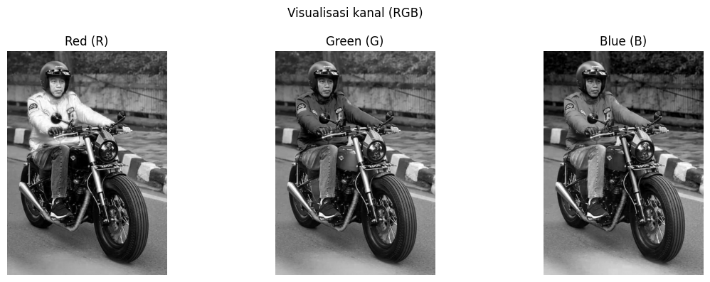

# Tugas Citra Digital

Proyek tugas mata kuliah **Citra Digital** — analisis fundamental citra digital menggunakan
Python. Notebook [`tugas citra digital.ipynb`](tugas%20citra%20digital.ipynb) menganalisis
citra `JKW.jfif` untuk memahami identitas berkas (format, mode warna, dimensi, jumlah kanal),
membaca nilai piksel, memvisualisasikan kanal warna, dan memverifikasi bahwa pembacaan
Pillow identik dengan representasi array NumPy.

| | |
| --- | --- |
| **Notebook utama** | [`tugas citra digital.ipynb`](tugas%20citra%20digital.ipynb) |
| **Bahasa** | Python 3 (Jupyter Notebook / Google Colab) |
| **Citra sumber** | [`data/JKW.jfif`](data/JKW.jfif) |
| **Library** | NumPy, Pandas, Pillow, Matplotlib |
| **Status** | Selesai — verifikasi seluruh data piksel **VALID** |

---

## 1. Latar Belakang

Citra digital pada dasarnya adalah kumpulan nilai numerik yang disusun dalam matriks
(baris = tinggi, kolom = lebar). Setiap nilai merepresentasikan intensitas cahaya pada
satu piksel. Sebelum melakukan operasi pemrosesan citra (filtering, segmentasi, deteksi
tepi, dan lainnya), hal pertama yang harus dilakukan adalah **memahami struktur
dan karakteristik citra** itu sendiri: format berkasnya apa, menggunakan mode warna apa,
berapa dimensi dan jumlah kanalnya, serta bagaimana nilai piksel yang dibaca oleh
library citra berkorespondensi dengan nilai yang tersimpan pada array NumPy.

Proyek ini menjawab pertanyaan-pertanyaan tersebut secara sistematis dan terdokumentasi.

## 2. Tujuan

1. Mengidentifikasi **metadata citra** secara lengkap: format berkas, mode warna, dimensi,
   jumlah kanal, bentuk array, tipe data, dan rentang nilai.
2. Memahami **arti setiap dimensi array** dan cara memetakan koordinat (x, y) ke indeks
   piksel.
3. Membandingkan pembacaan piksel melalui **dua jalur independen** — Pillow
   (`image.getpixel()`) dan NumPy (`array[y, x]`) — untuk memastikan konversi citra →
   array berjalan benar.
4. Memvisualisasikan citra asli, tiap kanal warna (R, G, B), serta representasi grayscale.

## 3. Data Masukan

| Aspek         | Keterangan                                   |
| ------------- | -------------------------------------------- |
| Nama berkas   | `JKW.jfif`                                   |
| Lokasi        | `data/JKW.jfif`                              |
| Format        | JPEG (deteksi otomatis oleh Pillow)          |
| Mode warna    | RGB                                          |
| Dimensi       | 552 × 775 piksel (lebar × tinggi)            |
| Total piksel  | 427.800                                      |
| Ukuran berkas | ± 62 KB                                      |

## 4. Metode Analisis

| Tahap | Langkah pada Notebook | Tujuan |
| ----- | --------------------- | ------ |
| 1 | Impor `numpy`, `pandas`, `matplotlib.pyplot` | Menyiapkan lingkungan analisis dan visualisasi |
| 2 | Deteksi lokasi citra (`CANDIDATE_PATHS`) | Membuat notebook portabel: jalan di Colab maupun lokal |
| 3 | `Image.open()` + `copy()` | Membaca citra tanpa mengubah objek aslinya, sekaligus mendeteksi format |
| 4 | `image.size`, `image.mode`, `image.getbands()` | Mengumpulkan metadata citra |
| 5 | `np.asarray(image)` | Mengubah citra menjadi array NumPy untuk analisis numerik |
| 6 | `image.getpixel((x, y))` vs `array[y, x]` | Verifikasi kecocokan nilai piksel pada titik uji |
| 7 | `plt.imshow()` dan pemisahan kanal | Visualisasi citra asli, kanal R/G/B, dan grayscale |
| 8 | Ringkasan dengan `pandas.DataFrame` | Menyajikan seluruh hasil analisis dalam satu tabel |

### Contoh Cuplikan Kode

```python
# Membaca citra dan membuat salinan agar objek asli tetap utuh
with Image.open(image_path) as opened_image:
    opened_image.load()
    image = opened_image.copy()
    detected_format = opened_image.format

# Mengubah citra menjadi array NumPy
original_array = np.asarray(image)

# Verifikasi: nilai Pillow harus sama dengan nilai NumPy
for px, py in [(0, 0), (551, 0), (0, 774), (551, 774), (276, 387), (10, 10)]:
    assert np.array_equal(np.asarray(image.getpixel((px, py))), original_array[py, px])
```

## 5. Hasil Analisis

| Aspek                      | Hasil                                     |
| -------------------------- | ----------------------------------------- |
| Format gambar              | JPEG                                      |
| Mode warna asli            | RGB                                       |
| Dimensi gambar             | 552 × 775 piksel                         |
| Total piksel               | 427.800                                  |
| Bentuk array asli          | `(775, 552, 3)`                          |
| Jumlah kanal / komponen    | 3 (Red, Green, Blue)                     |
| Tipe data array            | `uint8`                                   |
| Nilai minimum piksel       | 0                                         |
| Nilai maksimum piksel      | 255                                       |
| Verifikasi piksel Pillow ↔ NumPy | **VALID** (seluruh titik uji cocok) |

### Interpretasi

- **Mode RGB** berarti citra memiliki 3 kanal warna; setiap piksel disusun sebagai
  `(R, G, B)` sehingga array berukuran 3 dimensi: `(tinggi, lebar, kanal)`.
- **Tipe `uint8`** adalah integer unsigned 8-bit dengan rentang 0–255, sesuai standar
  intensitas warna 8-bit.
- **Bentuk `(775, 552, 3)`** menegaskan urutan indeks NumPy adalah `array[baris, kolom]`
  atau `array[y, x]` — bukan `array[x, y]`.
- **Status VALID** pada seluruh titik uji (sudut, tengah, dan koordinat (10, 10))
  membuktikan representasi array konsisten dengan pembacaan piksel Pillow.

## 6. Visualisasi

**Citra asli (mode RGB)**


**Pemisahan kanal warna R, G, dan B**



**Representasi grayscale (mode `L`)**


## 7. Struktur Repository

```
tugas-citra-digital/
├── .gitignore
├── README.md
├── requirements.txt
├── tugas citra digital.ipynb   # notebook analisis (lengkap dengan output & visualisasi)
├── assets/                      # gambar hasil visualisasi yang dirujuk README
│   ├── citra_asli.png
│   ├── kanal_rgb.png
│   └── grayscale.png
└── data/
    └── JKW.jfif                 # citra sumber
```

## 8. Cara Menjalankan

### Opsi A — Google Colab

1. Unggah `tugas citra digital.ipynb` ke Google Colab.
2. Hubungkan Google Drive, lalu jalankan sel berikut untuk menyalin citra sumber:

   ```python
   !cp "/content/drive/MyDrive/citra digital/JKW.jfif" /content/JKW.jfif
   ```

3. Jalankan seluruh sel: `Runtime > Run all`.

### Opsi B — Jupyter Notebook (lokal)

```bash
pip install -r requirements.txt
jupyter notebook
```

Buka `tugas citra digital.ipynb` lalu jalankan seluruh sel.

### Pencarian Lokasi Citra (Otomatis)

Notebook mencari `JKW.jfif` berurutan pada lokasi berikut, sehingga dapat dijalankan di
Colab maupun di komputer lokal tanpa mengubah kode:

1. `/content/drive/MyDrive/citra digital/JKW.jfif` — Google Colab / Google Drive
2. `data/JKW.jfif` — folder `data/` di samping notebook
3. `JKW.jfif` — folder kerja saat ini

## 9. Kebutuhan Library

| Library     | Fungsi                                            |
| ----------- | ------------------------------------------------- |
| NumPy       | Struktur array citra dan perhitungan numerik       |
| Pandas      | Penyajian metadata dan hasil verifikasi dalam tabel |
| Pillow      | Pembacaan berkas citra (JPEG) dan operasi piksel   |
| Matplotlib  | Visualisasi citra, kanal warna, dan grayscale       |
| Jupyter     | Menjalankan notebook secara interaktif              |

## 10. Penulis

**Wildan** — [okewildan647-dev](https://github.com/okewildan647-dev)
